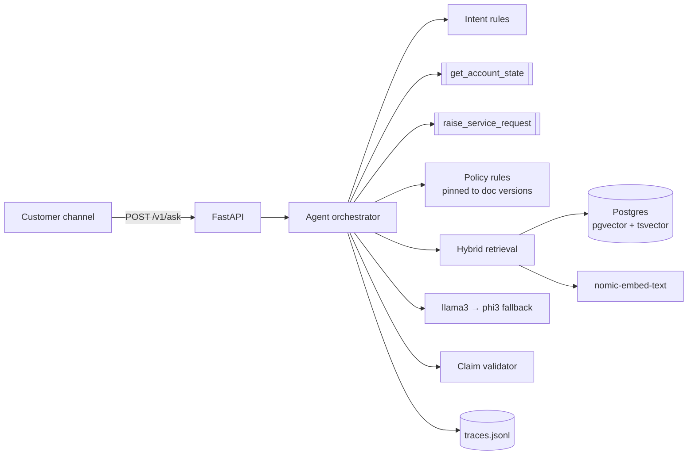

# Grounded card-servicing agent

A service agent that answers credit-card customers' questions from a governed policy
corpus and the customer's own account state. It cites every factual claim, and where
the corpus doesn't cover a question it refuses and routes to a human.
Python · FastAPI · PostgreSQL 18 + pgvector · Ollama (`nomic-embed-text`, `llama3` → `phi3`).
Everything runs locally; the synthetic data never leaves the machine.

**Eval: 32/36 passed (88.9%)**: 12 seeded cases + 24 of mine, 4 of which I predicted would
fail (31/32 predicted passes passed; 3/4 predicted failures failed). Details in [eval/results/summary.md](eval/results/summary.md). 72 unit tests pass.

---

## 1. What I built

A FastAPI endpoint (`POST /v1/ask`) runs one request through a small orchestrator.
**Rules route the intent.** Attacks and regulated decisions never reach the LLM.
The orchestrator **always calls `get_account_state`** (retrying the deliberate timeout).
**Credit-limit decisions are made by code**: mandatory declines with approved reason
codes, or a referral to `CREDIT_OPS`; the agent never approves. Disputes, card blocks,
complaints and statements go to the POL-SVC-006 queue via `raise_service_request`.
Everything else goes through **hybrid retrieval** (Postgres full-text + pgvector, fused
with RRF), an **evidence gate**, then **llama3 with a JSON schema whose citation field is
an enum of the source ids actually provided**. Every claim then passes a validator: each
figure must appear in the source it cites. The customer-facing message is built *only*
from fixed notices and validated claims; the response schema rejects anything else.
No evidence, an ungrounded model answer, or all claims failing validation → refuse and
raise a `GENERAL` request for human review.

## 2. What I deliberately did not build

- **Automatic limit approval.** Income and debt-burden ratio (POL-CRD-001 s.2–3,
  POL-CRD-002) are not available from the tool, so any approval would be invented.
  Eligible cases are referred.
- **An LLM intent classifier.** Rules are reproducible and testable for the intents that
  move money or carry regulatory weight. The cost is weaker paraphrase coverage (EV-030, EV-031).
- **Token streaming.** Claims are validated after generation; streaming unvalidated text
  would defeat the citation guarantee. See [DESIGN §6](docs/DESIGN.md#6-scale).
- **Auth, multi-tenancy, a re-ranker, an answer cache, OpenTelemetry.** Premature at 12
  documents and one tenant; [DESIGN §6](docs/DESIGN.md#6-scale) says where each would go.
- **Conversation memory.** Single-turn only.

## 3. What I would do next, with another day

1. Fix the EV-030 defect: block decision language on the QA path and re-route to the rules.
2. Run an LLM classifier *behind* the rules, for paraphrased and Hinglish limit requests
   (EV-030/031). It may only route *into* the deterministic path, never decide.
3. Let the validator accept arithmetic it can check itself (2.5% × 10,000 → minimum 500,
   EV-019), instead of rejecting any figure not literally in a source.
4. Streaming of progress events plus claim-by-claim release after validation.
5. Run the CI eval gate on GitHub and turn the eval into a regression gate: every case
   predicted to pass must pass.
6. Eval at temperature 0 with several repeats per case, to measure LLM variance.

## 4. What I would not trust, and how you'd find out

- **The intent regexes, and a real defect they expose (EV-030).** "Can I bump up how much
  I'm allowed to spend…" misses the limit rules and goes to policy QA, where llama3
  said *"You are not eligible for a credit limit increase at this time"*. That is a credit
  statement made by the model, not the rules, and it skipped the plain-language reason
  (open dispute, AA04). Every sentence was cited, so the validator passed it. The fix
  is a guard that rejects decision language (eligible / approved / declined) on the QA path
  and re-routes to the rules. Find more of these by sampling production questions per
  intent and grepping QA answers for decision verbs.
- **Completeness isn't checked, only correctness.** EV-023 answered "lounge access is
  included" but dropped "4 domestic visits per quarter". Each claim is cited; the omission
  isn't caught.
- **The evidence-gate threshold (0.68).** Tuned on this corpus, where out-of-corpus
  questions peaked at cosine 0.618. A larger corpus moves it. Track the refusal rate,
  and re-tune against labelled refusals.
- **36 eval cases is small**, the LLM is non-deterministic, and I wrote the cases knowing
  the design. One run's pass rate has wide error bars.
- **Thin-file detection uses internal history only**; the bureau trade-line condition in
  POL-CRD-003 isn't available from the tool, so a customer with a bureau file could be
  treated as thin-file.
- **SLA hours assume 24 h per working day** in `sla_hours`; the message quotes the
  policy's own wording.
- **The injection filter is pattern-based.** It caught POL-OPS-012, but a differently
  worded instruction in a *governed* document would reach the model. The defences
  behind it (sources-are-data prompt, citation enum, figure check, rules owning decisions)
  limit the damage but don't remove the risk.

---

## Architecture



| Component | Path |
|---|---|
| API | [app/api.py](app/api.py) |
| Orchestration | [app/agent/orchestrator.py](app/agent/orchestrator.py) |
| Intent routing | [app/agent/intents.py](app/agent/intents.py) |
| Policy rules | [app/agent/policy_rules.py](app/agent/policy_rules.py) |
| Prompt (versioned) / LLM client / validator | [prompts.py](app/agent/prompts.py), [llm.py](app/agent/llm.py), [guards.py](app/agent/guards.py) |
| Chunking, embeddings, hybrid store, ingest | [app/retrieval/](app/retrieval/) |
| Tools | [app/tools/account_tools.py](app/tools/account_tools.py) |
| Response schema | [app/schemas.py](app/schemas.py) |
| Tracing | [app/observability.py](app/observability.py) |
| Eval | [eval/](eval/) · Tests: [tests/](tests/) · CI: [.github/workflows/ci.yml](.github/workflows/ci.yml) |

## Execution flow

1. **Classify** the question (rules). Injection attempts and other-customer requests are
   refused here, with no tool calls.
2. **`get_account_state`**: up to 3 attempts on `UpstreamTimeout`; then `degraded`.
   `CustomerNotFound` → refusal.
3. **Dispatch**
   - limit → `assess_limit_increase`: decline (AA04 dispute, AA05 6-month bar, AA06 re-KYC;
     vulnerable = neutral decline, no sales content) or thin-file cap / referral to `CREDIT_OPS`
   - dispute, card block, statement, complaint, standing instruction → `raise_service_request`
   - internal or CIBIL score → refuse the score, list the approved reason codes
   - other → grounded QA:
     hybrid search → drop non-policy docs and the other product's section → evidence gate
     → llama3 (sources + non-internal account fields + code-computed facts) → validate
     → one retry with errors → refuse and route if nothing survives
4. **Respond** with a schema-valid `AgentResponse`; write the trace.

## Tool design and usage

Contracts exactly as in [data/tools.md](data/tools.md).
- `get_account_state(customer_id)`: 400 ms latency, `UpstreamTimeout` ~1 in 12
  (injectable RNG/rate for tests), `CustomerNotFound`, returns a copy.
- `raise_service_request(customer_id, category, summary)`: valid categories are **parsed
  from POL-SVC-006 at start-up**, so routing can't drift from policy; anything else
  raises `InvalidCategory`, never a guess.
- The agent never reads `accounts.json` directly. What the customer sees on timeout is
  designed per intent: limit requests get "nothing assessed, try again"; disputes and
  card blocks are still raised; policy questions are answered as general policy and
  flagged degraded.

## Key design decisions

| Decision | Why |
|---|---|
| Code decides, corpus justifies, LLM explains | A mis-sold limit is a compliance breach; decisions must be reproducible and unit-tested |
| Citations as a per-request **enum** in the output schema | llama3 cited document titles instead of ids; constrained decoding makes invented citations impossible |
| Figure check on every claim | Catches "right document, wrong number" |
| Rules pinned to document versions | If a policy document changes, `/health` reports it stale and limit cases go to a human instead of using old thresholds |
| Non-policy docs filtered at ingest + item-level injection stripping | POL-OPS-012 is a draft containing an instruction aimed at the model |
| Conflict resolution from the corpus itself | POL-CRD-011 says "POL-CRD-001 prevails" → parsed as `overridden_by`; recorded in `audit_notes` |
| Evidence gate = salient keyword OR cosine ≥ 0.68 | Vector search always returns *something*; similarity alone can't tell "covered" from "nearby" |
| Local models | Synthetic customer data stays on the machine, per the brief |

## Trade-offs and limitations

- **Latency**: llama3 on CPU (no GPU) takes 15–70 s per LLM turn. Rule-routed turns take ~0.4 s (the
  tool latency). On a GPU or a hosted model this drops to ~1–2 s.
- **Recall vs safety**: the strict validator and gate produce false refusals (EV-019)
  rather than false answers. In a bank that is the right side to fail on.
- **Rules vs flexibility**: regex intents are auditable but miss paraphrases (EV-030/031).
- Also see "What I would not trust" above, and [docs/DESIGN.md](docs/DESIGN.md) for the
  Break / Deploy / Scale write-up (failure table, cost per conversation, tenancy at 100×).

## Setup and run

Prerequisites: Python 3.12+, PostgreSQL with the **pgvector** extension, and
[Ollama](https://ollama.com) with the models pulled.

```powershell
ollama pull nomic-embed-text; ollama pull llama3; ollama pull phi3
python -m venv .venv; .venv\Scripts\activate
pip install -r requirements.txt
copy .env.example .env          # then set DATABASE_URL (user, password, port)
python scripts/setup_db.py      # creates the database + schema (pgvector, HNSW, GIN)
python -m app.retrieval.ingest  # chunks, embeds and loads the 12 policy documents
pytest -q                       # unit tests: no DB or model needed
python -m eval.run_eval         # full eval -> eval/results/summary.md (~15-25 min on CPU)
uvicorn app.api:app --port 8000 # API; docs at http://localhost:8000/docs
```

```powershell
curl.exe -s -X POST localhost:8000/v1/ask -H "Content-Type: application/json" `
  -d '{\"customer_id\":\"CUST-2003\",\"question\":\"I want my credit limit increased to 3 lakh.\"}'
python scripts/show_traces.py -n 5     # traces: spans, tokens, latency, errors
python scripts/demo_requests.py        # records real request/response pairs to docs/samples.md
```

Fault injection: `python -m eval.run_eval --cases EV-027,EV-028,EV-029,EV-036`
(account tool always times out / both models down). To simulate the primary model being down,
set `LLM_PRIMARY=does-not-exist`; the answer then comes from `phi3`.

Data: [data/](data/) is the supplied corpus, accounts, tool contracts and seed eval, unchanged.
The extended eval set is [eval/eval_cases.csv](eval/eval_cases.csv).
