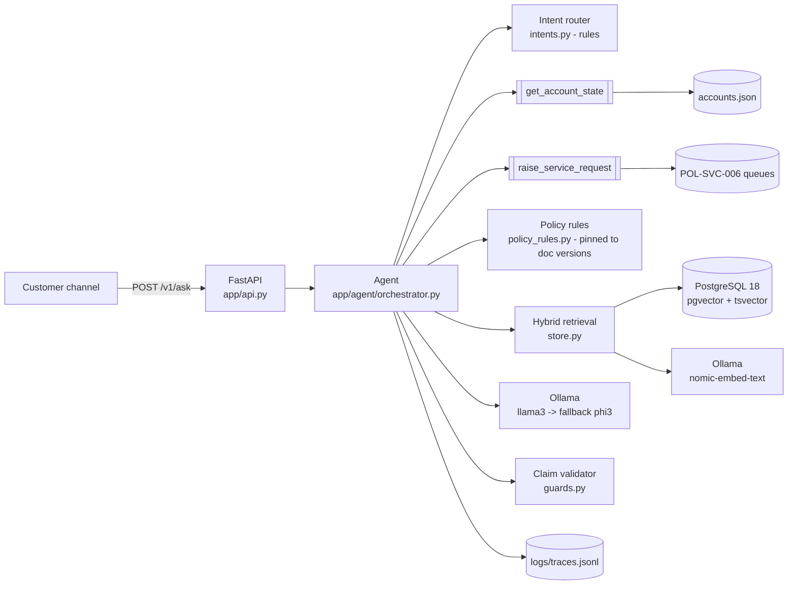

# Design notes

Companion to the one-page [README](../README.md). This covers architecture, the request
flow, tool design, the Break/Deploy/Scale questions from the brief, and how to demo it.

## 1. Architecture



| Layer | Module | Responsibility |
|---|---|---|
| API | `app/api.py` | `POST /v1/ask`, `GET /health`; Pydantic request/response validation |
| Orchestration | `app/agent/orchestrator.py` | intent → tools → rules or retrieval+LLM → validated response |
| Intent routing | `app/agent/intents.py` | deterministic regex routing; attacks and regulated intents never reach the LLM |
| Policy rules | `app/agent/policy_rules.py` | limit-increase declines/referrals, fee-waiver fact; every constant pinned to a doc version |
| Prompting | `app/agent/prompts.py` | versioned prompt + content hash (`PROMPT_ID`), per-request JSON schema |
| LLM | `app/agent/llm.py` | Ollama chat, structured output, primary→fallback model |
| Guards | `app/agent/guards.py` | citation, figure, internal-value and cross-product checks on every LLM claim |
| Retrieval | `app/retrieval/*` | chunking with governance metadata, embeddings, hybrid search, ingestion |
| Tools | `app/tools/account_tools.py` | the two supplied tools, contracts unchanged |
| Schemas | `app/schemas.py` | `AgentResponse` invariants (message = notices + cited claims) |
| Observability | `app/observability.py` | one JSON trace per request: spans, tokens, latency, errors |
| Eval | `eval/run_eval.py`, `eval/eval_cases.csv` | 36 cases, fault injection, pass-rate gate |

## 2. Request flow

1. **Classify** the question with rules (`intents.py`). Instruction-override attempts and
   requests about another customer are refused here, before any tool is called.
2. **`get_account_state`**: up to 3 attempts with 200/400 ms backoff on `UpstreamTimeout`.
   If it never answers, `account = None` and the response is marked `degraded`.
   `CustomerNotFound` is a refusal that discloses nothing.
3. **Dispatch**
   - *Limit increase / limit question* → `assess_limit_increase` (code, not the model).
     Mandatory declines from POL-CRD-001 s.3 (dispute, vulnerable, 6-month bar) and
     POL-KYC-008 produce `decline_with_reason` with approved reason codes (POL-GOV-009).
     Otherwise thin-file cap (POL-CRD-003) or the s.2 maximum is explained and the request
     is **referred** to `CREDIT_OPS`. The agent never approves: income and debt-burden
     ratio are not available from the tool.
   - *Dispute / card block / statement / complaint / standing instruction* →
     `raise_service_request` to the POL-SVC-006 queue; disputes state the provisional
     credit timeline unprompted. These still work when the account tool is down.
   - *Internal / CIBIL score* → refuse the score, offer the approved reason codes.
   - *Everything else* → grounded policy QA (below).
4. **Grounded policy QA**
   1. Hybrid search: Postgres full-text (`ts_rank_cd`, OR-query) and pgvector cosine,
      top-20 each, fused with Reciprocal Rank Fusion (k=60), top-5 kept.
   2. Evidence filter: drop non-policy documents (POL-OPS-012), drop the other card
      product's section of POL-PRD-010, annotate subordinate documents (POL-CRD-011
      "POL-CRD-001 prevails").
   3. **Evidence gate**: a chunk is evidence only if it matches a *salient* query term
      (in ≤20% of chunks, not conversational filler) or has cosine ≥ 0.68. No evidence →
      refuse and raise a `GENERAL` request (human review in 1 working day). No LLM call.
   4. LLM (llama3, temperature 0) gets sources tagged with ids, the customer's
      non-internal account fields, and code-computed facts (fee waiver). Output is
      constrained by a per-request JSON schema whose `citations` is an **enum of the
      provided ids**.
   5. `validate_claims`: every claim must cite, every figure in a claim must appear in
      the cited sources, no internal values, no other product. Failures → one retry with
      the errors fed back → invalid claims dropped → none left → refuse and route.
5. **Respond**: `message` is built only from fixed notices and validated claims; the
   schema rejects any other message. The trace is written to `logs/traces.jsonl`.

## 3. Tool design

Both tools are implemented exactly to `data/tools.md`.

- `get_account_state(customer_id)` sleeps 400 ms, raises `UpstreamTimeout` with
  probability 1/12 (injectable RNG and rate for tests and fault injection), raises
  `CustomerNotFound`, and returns a **copy** of the record.
- `raise_service_request(customer_id, category, summary)` accepts only queue names
  **parsed from POL-SVC-006 at start-up**, so routing cannot drift from policy. Anything
  else is `InvalidCategory`; it never guesses. Returns `{request_id, queue, sla_hours}`.
  Working-day SLAs are converted at 24 h per working day (an assumption; see limitations).
- The agent calls tools only through these methods; it never reads `accounts.json`.

## 4. Break: what the customer sees

| Failure | Handling | What the customer sees |
|---|---|---|
| Prompt injection **in the corpus** (POL-OPS-012 "SYSTEM NOTE") | Document classified `non_policy` at ingest (`Not policy`, `DRAFT`); the instruction-like item removed from `safe_text`; non-policy chunks never reach the LLM and are never citeable | Normal policy-based answer; the note has no effect |
| Prompt injection **in the question** (EV-012, EV-020) | Rule-based detection before any tool call | A refusal saying it only follows published policy, plus an offer to assess a limit request normally |
| Retrieval miss (travel insurance, fuel cashback) | Evidence gate, or model returns `grounded:false`, or every claim fails validation | "I don't have approved information… I won't guess" plus a `GENERAL` request reference and a 1-working-day human review |
| Tool timeout | 3 attempts; then `degraded` | Limit requests: `temporarily_unavailable`, "nothing assessed or submitted, try again". Disputes and card blocks: still raised. Policy questions: answered with "this is general policy, not a check of your account" |
| Contradictory documents (POL-CRD-011 3 months vs POL-CRD-001 6 months) | `overridden_by` parsed from "POL-CRD-001 prevails"; rules use 6 months; QA sources annotated | The 6-month answer. The conflict is recorded in `audit_notes` and the trace, not shown to the customer |
| Primary model down | Fallback model (phi3) | Same answer, `model: phi3` in the response |
| Both models down | `LLMUnavailable` | `temporarily_unavailable` plus a `GENERAL` follow-up request |
| Unknown category | `InvalidCategory` from the tool | `temporarily_unavailable`, "couldn't log your request" (it would be a code bug: queues are constants checked against the parsed set) |
| Model invents a citation or changes a figure | Enum-constrained schema; figure check | Claim dropped; if none left, refuse and route |
| Policy document edited after rules were written | Version pin mismatch at start-up (`/health` shows `stale_policy_documents`) | Limit requests go to a human (`GENERAL`) instead of using stale thresholds |

## 5. Deploy

- **Traces**: `logs/traces.jsonl`, one record per request: spans (tool attempts, retrieval
  hits with RRF, cosine and lexical rank, LLM attempts, validation results), errors,
  per-call model, prompt id and tokens, total latency. `python scripts/show_traces.py`.
- **Token accounting**: Ollama `prompt_eval_count` / `eval_count` per call, summed per trace
  and reported per eval case in `eval/results/summary.md`.
- **Prompt versioning**: `PROMPT_ID = policy-qa/v2+<sha256 of template+schema>`, recorded
  in every response and trace. The hash catches template edits even if nobody bumps the version.
- **Eval gate in CI**: `.github/workflows/ci.yml`. Unit tests on every push; on pull
  requests, the full eval against real pgvector and Ollama with `--min-pass-rate`.
  *Written but not yet run on GitHub.*
- **Model fallback**: `LLM_PRIMARY` → `LLM_FALLBACK`; tested by fault injection (EV-036)
  and a unit test.
- **Policy change safety**: version pins (above). Re-ingest is idempotent (content SHA).

## 6. Scale

**Caching.** Query embeddings are LRU-cached in-process. The system prompt is static
and first in the message, so a provider-side prompt cache (or Ollama's KV reuse) can
cover it. Answers themselves are *not* cached: they depend on live account state. The
safe cache is (normalised question, retrieved chunk ids, relevant account fields,
prompt id) → validated claims, invalidated on re-ingest. I would add it only once traffic
shows repeated questions.

**Cost per conversation.** Measured on the final eval run (`eval/results/summary.md`): the 14
cases that used the LLM averaged 635 prompt + 99 completion tokens (up to ~1,200 prompt
tokens when the validator forced a retry). Deterministic turns (limits, disputes, refusals)
use **zero** LLM tokens. Locally the cost is CPU time: 37 s mean per LLM turn on this laptop,
which has no GPU. On a hosted small model at roughly $0.25/M input and $1.25/M output tokens, an LLM
turn is about $0.0003, so a 4-turn conversation is well under $0.002. Latency, not cost, is
the constraint.

**Streaming.** Not implemented on purpose: claims are validated *after* generation,
and streaming unvalidated tokens to a customer defeats the citation guarantee. The right
design is to stream *progress* events (SSE: "checking your account", "checking policy")
and then the validated answer, or stream claim by claim, releasing each one after it
passes validation.

**Concurrency.** The `/v1/ask` handler is sync, so FastAPI runs it on its worker thread
pool. Postgres access goes through a `psycopg_pool` (max 10), and the tool RNG and
request log are lock-protected. The bottleneck is the single local Ollama instance:
in production that becomes a pooled inference endpoint with per-tenant rate limits and
a timeout budget per request.

**100x corpus, split across tenancies.**
- Add `tenant_id` to `policy_documents` and `policy_chunks`, and enforce it with Postgres
  row-level security, not just a `WHERE` clause. Partition or list-partition by tenant.
  The HNSW index is already in place, but filtered ANN needs care: use per-tenant
  partial indexes or pgvector iterative scans so the tenant filter doesn't starve top-k.
- Chunking by section will produce many more near-duplicate chunks: add a cross-encoder
  re-ranker after RRF and re-tune the evidence gate per tenant against an eval set.
- Document-frequency salience comes from `ts_stat` at start-up; at 100x it would be a
  materialised table refreshed on ingest.
- Governance metadata (status, `overridden_by`, effective dates) becomes a proper
  precedence model: supersession across versions, effective-date filtering, and an
  owner sign-off before a document becomes `policy`.
- Version pins per tenant: rules become per-tenant config with the same stale-doc check.

## 7. Demo

```powershell
.venv\Scripts\uvicorn app.api:app --port 8000
```

```powershell
# limit request with an open dispute -> mandatory decline, AA04
curl.exe -s -X POST localhost:8000/v1/ask -H "Content-Type: application/json" `
  -d '{\"customer_id\":\"CUST-2003\",\"question\":\"I want my credit limit increased to 3 lakh.\"}'
```

Sample request/response pairs from real runs are in `docs/samples.md`, and every eval
response is in `eval/results/summary.md`.
